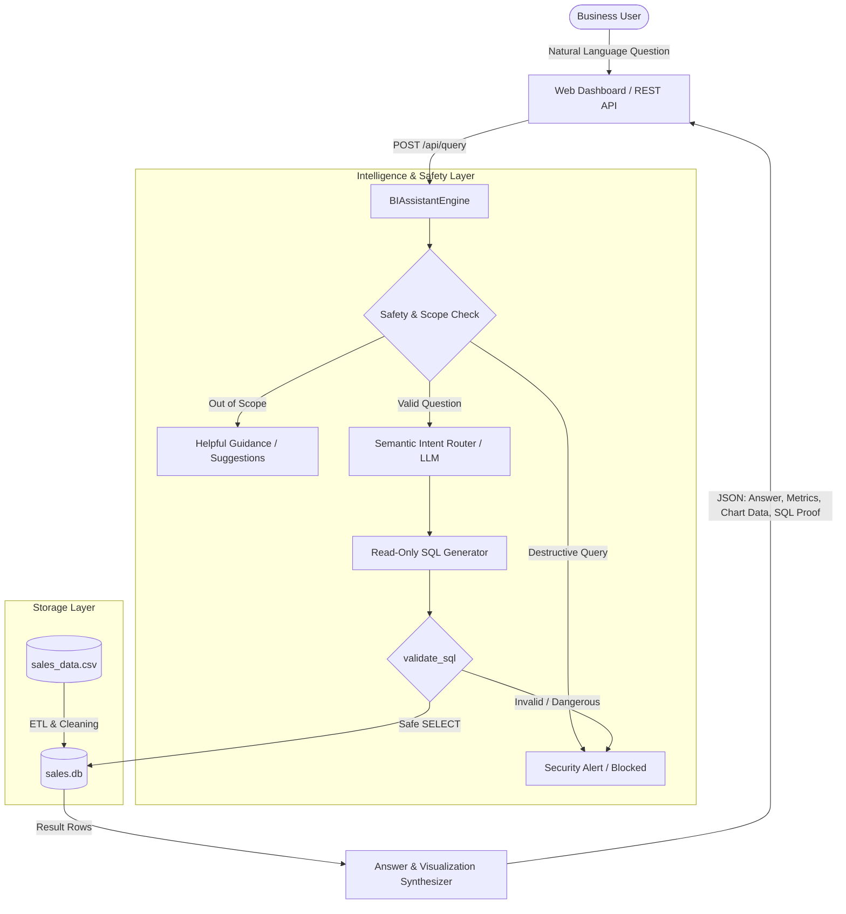

# 📊 AI Sales Business Intelligence Assistant

An intelligent, lightweight Natural Language Business Intelligence (BI) Assistant that translates plain English business questions into verified, read-only SQL queries against a transactional sales database, returning formatted natural language answers, key metrics, dynamic charts, and supporting data.

Built for the **AI-Assisted Development Challenge for Graduate Engineer Trainee (GET)** selection.

---

## 🌟 Key Features

- **Natural Language to SQL (Text-to-SQL):** Supports all 5 challenge questions plus regional, product, channel, and data quality queries.
- **Two-Tiered Architecture:**
  1. *Tier 1 (AI / LLM Mode):* Integrates with Google Gemini / OpenAI via API key if configured.
  2. *Tier 2 (Deterministic Semantic Engine):* Zero external API key required. Runs 100% offline with guaranteed mathematical correctness.
- **Strict SQL Safety Guardrails:** Queries must start with `SELECT`/`WITH` and are validated against all destructive operations (`DROP`, `DELETE`, `UPDATE`, `INSERT`, `ALTER`, `TRUNCATE`). Multi-statement queries are strictly prohibited.
- **Automated Data Quality & ETL:** Cleans raw CSV data, normalizes dates to ISO-8601, computes gross and net revenue, handles missing unit prices via catalog imputation, and flags non-revenue transactions (returns, zero quantity).
- **Interactive Modern Web Dashboard:** Sleek glassmorphic UI with KPI cards, Chart.js visualizations, collapsible SQL query viewer, and a live Data Cleaning Audit drawer.
- **Comprehensive Test Suite:** 15 unit and integration tests runnable via `pytest -q`.

---

## 🏗️ Architecture Diagram



---

## 📂 Repository Structure

```text
sales-bi-assistant/
├── data/
│   ├── sales_data.csv          # Source transactional sales dataset
│   └── sales.db                # SQLite database generated via automated ETL
├── static/
│   ├── css/
│   │   └── style.css           # Modern dark-mode glassmorphic styling
│   └── js/
│       └── app.js              # Client-side UI logic and Chart.js integration
├── templates/
│   └── index.html              # Interactive BI dashboard template
├── tests/
│   ├── __init__.py
│   └── test_assistant.py       # 15 automated pytest unit and integration tests
├── AI_USAGE.md                 # Complete AI reflection and engineering report
├── README.md                   # Architecture, setup, schema, and API documentation
├── app.py                      # Flask web application and REST API server
├── db.py                       # SQLite database ETL, data cleaning, and query runner
├── engine.py                   # Natural Language query processor & analytics synthesizer
├── requirements.txt            # Project dependencies (Flask, pytest)
└── .gitignore                  # Git ignore rules
```

---

## 🗄️ Database Design & Schema

The dataset is ingested into an indexed SQLite database table named `sales`:

| Column | Type | Description |
| :--- | :--- | :--- |
| `transaction_id` | `TEXT PRIMARY KEY` | Unique transaction identifier (e.g. `TXN0001`) |
| `order_date` | `TEXT` | Standardized ISO-8601 date (`YYYY-MM-DD`) |
| `raw_order_date` | `TEXT` | Original date string from CSV (`DD-MM-YYYY`) |
| `month` | `TEXT` | Monthly bucket (`YYYY-MM`) for aggregation |
| `product` | `TEXT` | Product name (e.g. `Monitor`, `Office Chair`) |
| `category` | `TEXT` | Category (`Electronics`, `Accessories`, `Furniture`) |
| `region` | `TEXT` | Sales region (`North`, `South`, `East`, `West`) |
| `sales_channel` | `TEXT` | Channel (`Online`, `Retail`) |
| `quantity` | `INTEGER` | Quantity of units ordered |
| `unit_price` | `REAL` | Unit selling price in INR |
| `discount_amount`| `REAL` | Total discount applied |
| `gross_revenue` | `REAL` | Calculated: `quantity * unit_price` |
| `net_revenue` | `REAL` | Calculated: `gross_revenue - discount_amount` |
| `status` | `TEXT` | Transaction status (`Completed`, `Returned`) |
| `is_valid` | `INTEGER` | `1` if completed revenue sale, `0` if returned/zero qty |
| `cleaning_notes` | `TEXT` | Audit trail of preprocessing transformations |

### Data Cleaning Rules
1. **Status `'Returned'` (e.g. `TXN0033`):** Marked `is_valid = 0` and `net_revenue = 0.0`. Preserved in database for return-rate tracking but excluded from net sales revenue calculations.
2. **Quantity `<= 0` (e.g. `TXN0034`):** Marked `is_valid = 0`. Non-productive transaction excluded from revenue.
3. **Missing `Unit_price` (e.g. `TXN0051`):** Imputed with `1,200.00` based on catalog pricing of `Laptop Stand`. Logged in `cleaning_notes`.

---

## 🚀 Quickstart Guide

### 1. Clone & Navigate to Repository
```bash
git clone https://github.com/YOUR_USERNAME/sales-bi-assistant.git
cd sales-bi-assistant
```

### 2. Install Dependencies
```bash
pip install -r requirements.txt
```

### 3. Run Automated Tests
```bash
pytest -q
```
*Expected Output: `15 passed in ~1.2s`.*

### 4. Start the Application Server
```bash
python app.py
```
Open your browser and navigate to:
```
http://localhost:5000
```
*(In cloud environments like Antigravity, Replit, or GitHub Codespaces, copy the generated public forwarded URL).*

---

## 💡 Analytics & Example Queries

| Example Question | Intent | Calculated Result (Ground Truth) |
| :--- | :--- | :--- |
| **"What is the total revenue?"** | `TOTAL_REVENUE` | **₹1,445,200.00** across 49 completed orders (Gross: ₹1,449,700.00; Discounts: ₹4,500.00) |
| **"Which product generated the highest revenue?"** | `HIGHEST_PRODUCT_REVENUE` | **Monitor** with **₹473,000.00** (32.7% share), followed by Desk (₹222,500.00) |
| **"What is the monthly revenue trend?"** | `MONTHLY_TREND` | Spans 6 months (Jan–Jun 2026). Peak month: **May 2026** at **₹318,500.00** (+32.3% MoM) |
| **"Which region generated the highest sales?"** | `HIGHEST_REGION_SALES` | **South** with **₹411,200.00** (28.5% share), followed by North (₹384,450.00) |
| **"How did revenue change between April and May?"** | `MONTH_COMPARISON` | Revenue increased by **+₹77,800.00** (**+32.32%**) from ₹240,700.00 to ₹318,500.00 |

---

## 🛡️ Security & Guardrails

- **SELECT / WITH Only:** The engine strictly validates all SQL queries before execution using regular expressions and semantic rules.
- **Prohibited Keywords:** Any query matching `DROP`, `DELETE`, `UPDATE`, `INSERT`, `ALTER`, `TRUNCATE`, `ATTACH`, `DETACH`, or `PRAGMA` is blocked immediately.
- **Anti-Chaining:** Multiple statement delimiters (`;`) followed by non-whitespace are rejected to prevent SQL injection chaining.

---

## 🔌 API Endpoints

### `POST /api/query`
Executes a natural language business question.
```json
// Request
{
  "question": "What is the total revenue?"
}

// Response
{
  "question": "What is the total revenue?",
  "intent": "TOTAL_REVENUE",
  "answer": "The total net revenue generated is ₹1,445,200.00 across 49 completed orders...",
  "sql_query": "SELECT SUM(net_revenue) AS total_net_revenue ... FROM sales WHERE is_valid = 1;",
  "supporting_data": [ ... ],
  "metrics": {
    "Net Revenue": "₹1,445,200.00",
    "Completed Orders": "49"
  },
  "chart_type": "metric",
  "is_valid": true
}
```

### `GET /api/stats`
Returns high-level KPI metrics (total revenue, completed orders, unique products, date range).

### `GET /api/data`
Returns transaction records with data quality audit notes.

---

## 🧪 Testing Summary

Run tests with:
```bash
pytest -q
```
Test suite includes:
- `test_q1_total_revenue`: Accurate total net revenue & valid order count.
- `test_q2_highest_product_revenue`: Identifies Monitor as top revenue driver.
- `test_q3_monthly_revenue_trend`: Validates 6-month progression and peak month.
- `test_q4_highest_region_sales`: Identifies South region as top seller.
- `test_q5_revenue_change_between_two_months`: Calculates exact MoM delta and percentage.
- `test_edge_case_returned_transaction`: Verifies exclusion of returned order `TXN0033`.
- `test_edge_case_zero_quantity_transaction`: Verifies invalidation of zero-qty order `TXN0034`.
- `test_edge_case_missing_unit_price_imputation`: Verifies price imputation on `TXN0051`.
- `test_security_block_destructive_drop`: Blocks DROP TABLE attempts.
- `test_security_block_destructive_delete`: Blocks DELETE FROM attempts.
- `test_security_block_destructive_update`: Blocks UPDATE attempts.
- `test_empty_question`: Handles empty queries gracefully.
- `test_out_of_scope_question`: Handles out-of-domain questions with suggestions.
- `test_api_query_endpoint`: Tests API request/response format.
- `test_api_stats_endpoint`: Tests API KPI data delivery.
